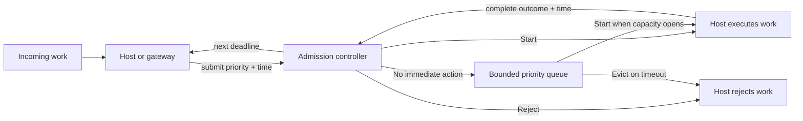

# Adaptive Admission Controller

Adaptive Admission Controller protects a service as it approaches saturation. Instead of enforcing
a fixed request rate, it decides which work may start from the service's observed capacity, recent
latency, and request priority.

It evolves the design originally explored in
[`rate-limit-pid-controller`](https://github.com/jfrz38/rate-limit-pid-controller), inspired by
Uber's Cinnamon load-shedding architecture. It combines priority-aware shedding, PID-controlled
admission, and adaptive concurrency in a deterministic, portable state machine.

## Why admission control?

A rate limiter answers "has this client exceeded a quota?" Admission control answers a different
question: "can the service safely start this work now?"

When all execution slots are busy, the controller can hold bounded work in a priority queue. Under
sustained pressure it reduces admission of less important requests, while continuing to protect
higher-priority work. It learns from completed executions to adjust admission, queue timeouts, and
concurrency.

This is useful when a service needs to:

- Avoid accepting more concurrent work than it can handle.
- Preserve capacity for important requests during overload.
- Queue a bounded amount of work instead of creating an unbounded backlog.
- Adapt to changing service latency and throughput rather than relying only on static limits.

## How it works

The controller is a synchronous state machine. The **host** owns HTTP requests, tasks, timers, and
I/O; the **controller** owns admission decisions and control state.



A typical interaction is:

```text
host receives request A
host -> submit(priority, 1000)
controller -> Start(request_id=1)
host executes A
host -> complete(1, Success, 1080)
controller records an 80 ms execution and may start queued work
```

Calls to one controller instance must be serialized. The host supplies monotonic timestamps,
executes returned actions in order, reports outcomes, and schedules the controller's next deadline.
This explicit boundary keeps behavior deterministic and allows the same algorithm to run natively or
as a WebAssembly component.

## What the controller provides

- **Priority-aware admission:** priorities range from `0` to `767`; lower values are more important.
- **Bounded execution:** the controller never starts work beyond its current concurrency limit.
- **Bounded queueing:** queued work is ordered by priority and FIFO within the same priority.
- **Lifecycle decisions:** explicit start, reject, evict, cancel, threshold-change, and
  concurrency-change actions.
- **Adaptive control:** PID feedback changes the admission threshold, while observed execution data
  informs queue timeouts, concurrency, and target latency.
- **Deterministic time:** the host provides time, so tests and different embeddings can reproduce the
  same decisions from the same event sequence.
- **Portable contracts:** a WIT interface and language-neutral conformance scenarios define the
  WebAssembly boundary.

## Is it a fit?

The project is designed for a native application, language runtime, proxy, or gateway that can:

- Keep a request or task while it waits and resume it later.
- Schedule a wake-up for the next controller deadline.
- Report completion, failure, cancellation, and shutdown.
- Retain one stateful controller at a clearly defined worker or process scope.

It does **not** provide an HTTP server, asynchronous runtime, distributed coordination, or a global
limit across processes and nodes. A platform with only a synchronous allow/reject hook can use
immediate admission, but cannot reproduce priority queueing safely.

## Project components

The project separates the portable implementation from its cross-language contract:

| Artifact | Intended use |
| --- | --- |
| `adaptive-admission-core` | Native Rust state machine with no production dependencies. |
| `adaptive-admission-component` | WebAssembly Component Model wrapper around the core. |
| WIT contract | Callable types and operations exposed to WebAssembly hosts. |
| Conformance scenarios | Language-neutral traces used to validate host implementations. |

Host-language packages and gateway-specific adapters are separate consumers. They are not maintained
in this repository.

## Embed the controller

### Use the native Rust core

Create a controller and submit work metadata:

```rust
use adaptive_admission_core::{Action, Config, Controller, Priority};

let mut controller = Controller::new(Config::default())?;
let submission = controller.submit(Priority::new(100)?, 1_000.into())?;

assert_eq!(
    submission.actions,
    vec![Action::Start {
        request_id: submission.request_id,
    }],
);

# Ok::<(), Box<dyn std::error::Error>>(())
```

An embedding must also process every returned action, call `complete` for started work, and drive
`next_deadline`. See the [host adapter contract](docs/host-adapters.md) before building an
integration.

### Build the WebAssembly component

The repository pins its Rust toolchain. With GNU Make available, install the pinned component tool
and build the artifact:

```bash
make install-wasm-tools
make component
```

The validated component is written to:

```text
target/wasm32-unknown-unknown/release/adaptive_admission_component.component.wasm
```

It targets `wasm32-unknown-unknown` and imports no ambient WASI clock, randomness, or I/O. Hosts in
other languages should consume the released component and implement the WIT and host-adapter
contracts rather than reimplementing the algorithm.

## Development

List the available development commands:

```bash
make
```

Run the checks required by CI:

```bash
make check
```

Run only the shared conformance contract:

```bash
cargo test -p adaptive-admission-core --test conformance
```

## Documentation

| Document | Read it when... |
| --- | --- |
| [Architecture and scope](docs/architecture.md) | You want to understand the control model, boundaries, guarantees, and limitations. |
| [Host adapter contract](docs/host-adapters.md) | You are embedding the component in a language runtime or gateway. |
| [Conformance scenarios](conformance/README.md) | You are validating another host or implementation against the observable contract. |
| [Release process](docs/releasing.md) | You maintain versions or publish release artifacts. |

## Releases

Versioned releases keep the native core, WebAssembly component, WIT contract, and conformance
scenarios aligned. See the [release process](docs/releasing.md) for the artifact and publication
contract.

## References

- [Cinnamon: Using Century Old Tech to Build a Mean Load Shedder](https://www.uber.com/en-ES/blog/cinnamon-using-century-old-tech-to-build-a-mean-load-shedder/)
- [PID Controller for Cinnamon](https://www.uber.com/en-ES/blog/pid-controller-for-cinnamon/)
- [Cinnamon Auto-Tuner: Adaptive Concurrency in the Wild](https://www.uber.com/en-ES/blog/cinnamon-auto-tuner-adaptive-concurrency-in-the-wild/)

## License

Distributed under the [MIT License](LICENSE).
